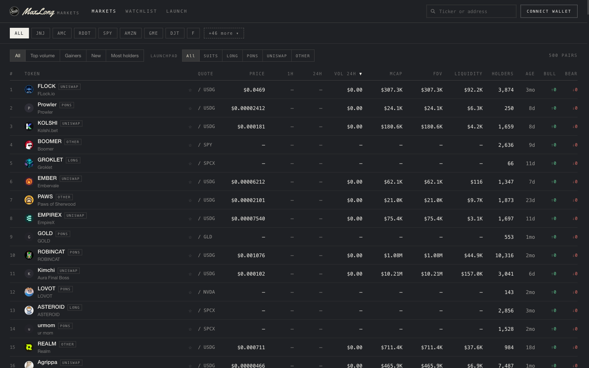
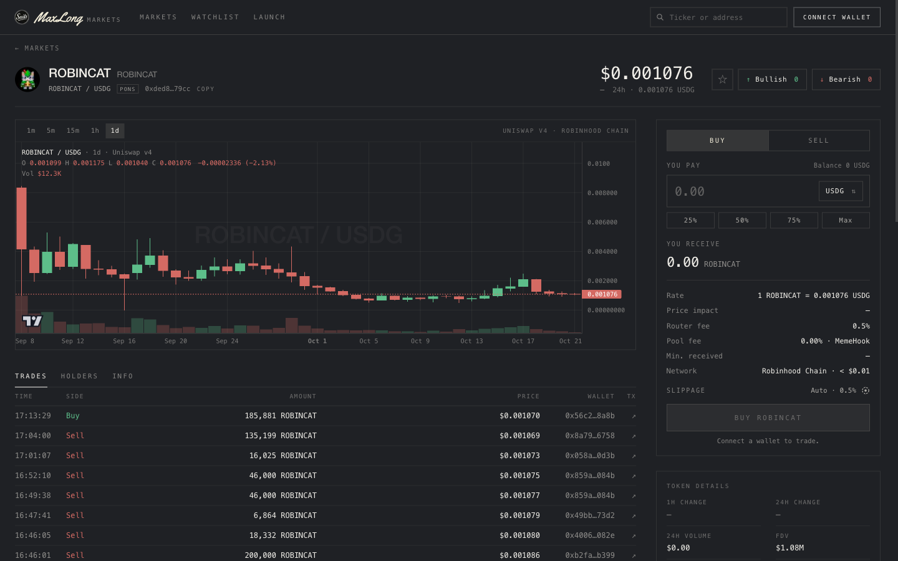
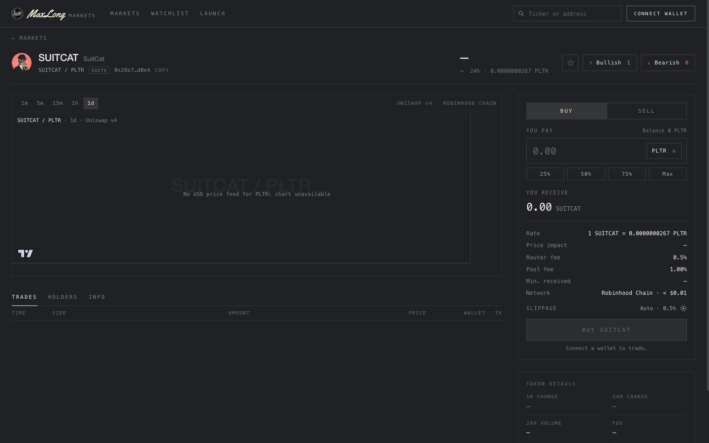
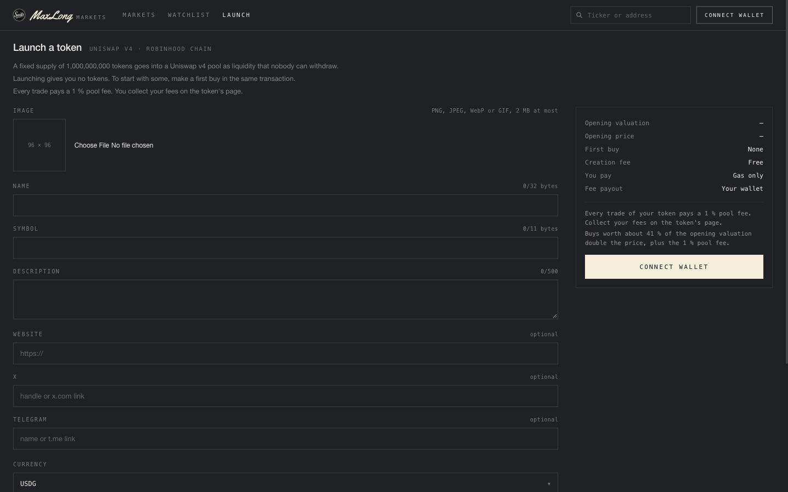
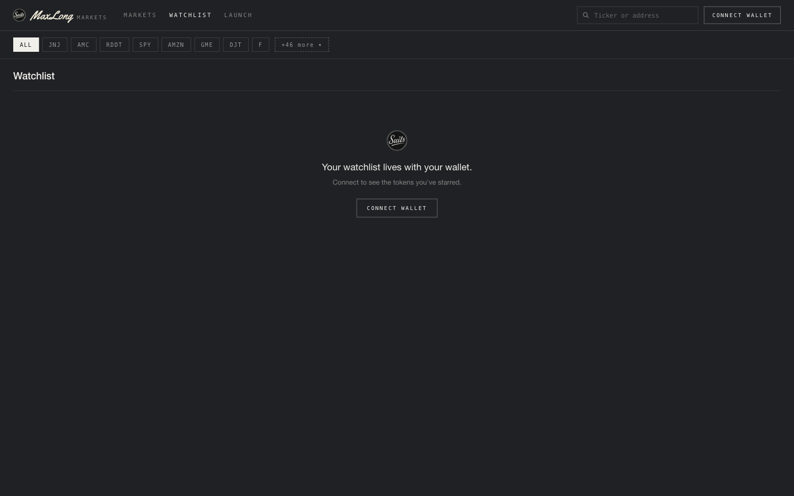
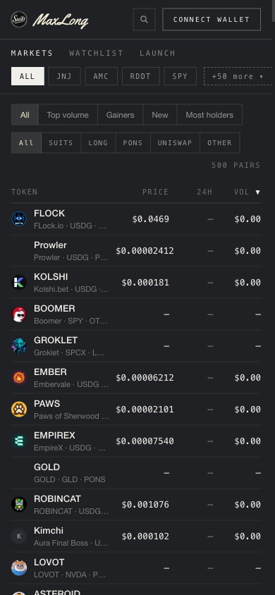
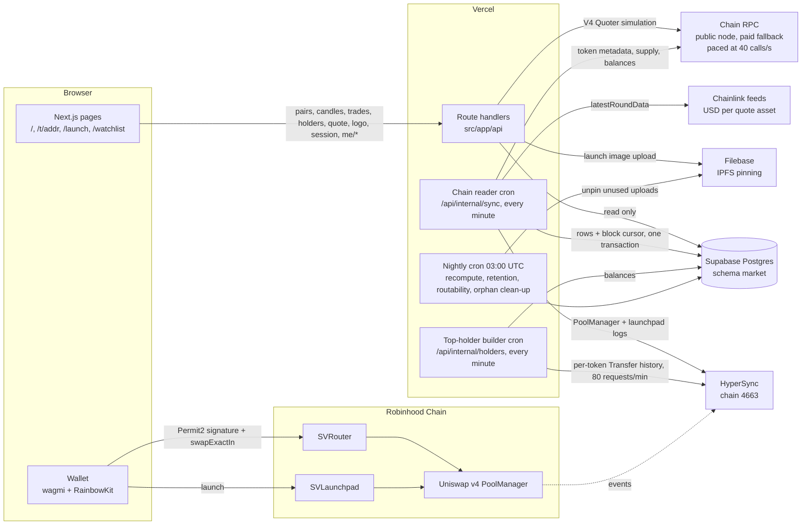

# MaxLong Markets: frontend, API and chain reader

MaxLong Markets is a market for stock-paired memecoins on Robinhood Chain (chain id 4663, an Arbitrum Orbit L2). It
lists every Uniswap v4 pool on the chain whose one side is an allowlisted quote asset (Robinhood's tokenized stocks
such as PLTR, NVDA and SPCX, plus USDG), from any launchpad; prices and executes swaps through the project's own fee
router; adds Sign-In with Ethereum, a server-side watchlist and bullish/bearish votes; and has an instant launchpad
that deploys a token and seeds its pool in one transaction. This repository is the whole off-chain side: the Next.js
app, its 21 API route handlers, the chain reader and top-holder builder that run as Vercel crons, and the Postgres
schema they write. Kobs built it for the client MAXLONG between 10 Sep and 23 Oct 2026.

Live: **https://www.maxlong.markets** (Vercel, Supabase Postgres). The contracts are in
[suitventures-markets-contracts](https://github.com/maxlong-markets/suitventures-markets-contracts); the system
overview and Decision Log are in [suitventures-markets](https://github.com/maxlong-markets/suitventures-markets).

| Thing | Value |
|---|---|
| SVRouter (0.5 % fee, Permit2 pull, Universal Router forward) | [`0xc9E6b76aA834e746080b1F8Ad6943930eD5147a9`](https://robinhoodchain.blockscout.com/address/0xc9E6b76aA834e746080b1F8Ad6943930eD5147a9) |
| SVLaunchpad (1 B supply, full-range single-sided v4 position it can never withdraw, 1 % pool fee) | [`0x7885AFbda28F5a4d5c6Cc4230975c983d6c7aA0d`](https://robinhoodchain.blockscout.com/address/0x7885AFbda28F5a4d5c6Cc4230975c983d6c7aA0d) |
| Uniswap v4 PoolManager / Universal Router / Permit2 | `0x8366a39C…e40951` / `0x06AfBA43…a6bf99` / `0x000000000022D473030F116dDEE9F6B43aC78BA3` |
| Health | [`/api/health`](https://www.maxlong.markets/api/health): reader age and last error, lag in blocks, stale USD feeds, holder builder cycle |

## Screenshots

| | |
|---|---|
|  |  |
| Markets: every listed pair, filtered by quote asset and launchpad | Token page: candles, trades, holders, and the trade panel priced by the V4 Quoter |
|  |  |
| A launchpad-made token: SUITS origin chip, 1 % pool fee | Launch: image, name, symbol, currency, opening valuation, optional first buy |
|  |  |
| Watchlist, stored server-side per signed-in wallet | The same table at 390 px |

## Architecture



The UI reads only this app's own routes, and the routes read only the store. Nothing on a page request waits on
HyperSync or a chain scan. The one exception is the quote route, which simulates the V4 Quoter per request and
answers both the display numbers and the exact call block the wallet signs.

## Engineering decisions worth reading

**1. Replacing the hosted indexer with an in-house chain reader.** The app first read an Envio HyperIndex
deployment. Profiling on 21 Sep 2026 showed why it kept falling over: by 16 Sep it had processed 859 M events, 93 %
of them ERC-20 `Transfer`s from the 132,000 registered tokens, at 9 to 25 M events a day, against a USD 70/month
plan sized for about 1 M stored events. Dropping transfers still left 0.9 to 2.5 M swaps a day. The reader that
replaced it lives in the existing minute cron: one HyperSync query for the PoolManager's `Initialize`, `Swap` and
`ModifyLiquidity` (plus the launchpad's three events), a pure fold ported from the indexer with its tests, and one
Postgres transaction that writes the rows and advances the block cursor together, so a crash replays a batch and
never half-applies one. It reads to `head - 30` blocks (about 3 s) to stay clear of reorgs. Cost: holder counts are
no longer exact from transfers; they come from a stored baseline moved by trades, with exact lists from decision 5.
Design: [docs/superpowers/specs/2026-09-21-chain-reader-design.md](docs/superpowers/specs/2026-09-21-chain-reader-design.md).

**2. Read metadata before the fold; never let one row throw.** A token created and traded in the same batch must be
priced with its real decimals, so the runner names every new token first, reads its metadata, then folds; the old
"read after" shape would have priced those first trades and five candles at the 18-decimal fallback forever. And
because the fold runs inside the batch's one transaction, a throw on a single bad row (a pool with no token row, a
garbage price copied from the old indexer) rolled back the whole batch and wedged the reader on that block. Handlers
now skip and count such events (`orphanedTokens`, `skippedLiquidity`) instead of throwing
([src/lib/chain/fold.ts](src/lib/chain/fold.ts), [src/lib/chain/run.ts](src/lib/chain/run.ts)).

**3. RPC pacing at 40 calls a second, found by measurement.** Holder counts froze at their baseline. Measuring the
public node from one address showed it meters calls, not HTTP requests: one batch of 40 per second sustained for
20 s answered 800 of 800; two batches of 40 in the same second answered 40 of 1,600; the penalty clears within a
second. Vercel functions leave from a small shared pool of addresses, so every server-side call now goes through one
rolling-window limiter in front of viem's transport, batched at 40
([src/lib/chain/pacing.ts](src/lib/chain/pacing.ts)).

**4. A lease equal to `maxDuration`.** Candle volume and pool running totals are additive, so folding the same block
range twice double-counts. Each cron job takes a lease with one conditional `UPDATE` in `market.sync_state`, and the
lease is 300 s, the same as the route's `maxDuration`: Vercel cannot run an invocation longer than that, so a second
writer over the same cursor is structurally impossible rather than unlikely. The cost is that a hard-killed run
stalls the job for up to five minutes ([src/app/api/internal/sync/route.ts](src/app/api/internal/sync/route.ts)).

**5. The top-holder builder's request budget.** Exact holder lists need each token's full `Transfer` history. The
builder folds it per token from HyperSync into `market.token_balances`, spacing requests 750 ms apart (80 a minute)
on a 100-a-minute key so the reader keeps its share, dropping to the advertised budget minus 10 on a smaller key, and
marking a token `skipped` past 1 M holders or 30 M transfers. Lists are built for covered tokens and on demand when a
holders tab is opened ([docs/superpowers/specs/2026-09-23-top-holders-design.md](docs/superpowers/specs/2026-09-23-top-holders-design.md)).

**6. The store is the only thing the UI reads.** Every route reads Postgres; the crons are the only writers. A paused
reader costs freshness (24-hour volume and change go stale) and never the table, the token pages or trading, which
prices against the chain directly. Public reads carry short `s-maxage` headers so the CDN absorbs traffic.

**7. SIWE sessions without a session table.** The nonce is 16 CSPRNG bytes sealed with HMAC in a 10-minute cookie
(viem's `generateSiweNonce` uses `Math.random` and was rejected), spent on success. The server checks domain, chain
id, version, nonce, a mandatory expiry and the signature (EIP-1271 and ERC-6492 for smart accounts), then sets an
HttpOnly, SameSite=Lax, Secure, 7-day HMAC-signed cookie. `/api/me/*` takes the wallet from that cookie only. The
trade-off, no server-side revocation, is written up in [SECURITY.md](SECURITY.md) (F-9).

**8. Health that cannot lie, and the trimmed-env lesson.** The in-process memo serves its last good value when a
reload throws; wrapped around the health check, that would have pinned `/api/health` at "healthy" for a whole
outage. Health memoises the outcome for 5 s, never an exception, and answers 503 when anything is wrong. Separately,
on 29 Sep a Filebase bucket name pasted with a leading newline sent every upload to a bucket that did not exist; every
such setting is now trimmed, and health reports the lengths (never the values) so a stray character shows up.

## Security

Summary of [SECURITY.md](SECURITY.md): wallet identity comes only from a verified SIWE session; cron routes need a
constant-time bearer check and a lease; uploads are gated on the launchpad's own `isAllowedLauncher`, size-capped,
magic-byte sniffed and re-encoded by sharp; the logo proxy only fetches https on 443, re-checks every redirect and
serves raster types only; SQL is parameterised; errors never carry driver messages or URLs. The review fixed one
issue in place (an unbounded, insertion-ordered in-process memo, now a capped LRU) and leaves open, with recommendations, a Next.js upgrade for current
advisories, security headers, a DNS-level SSRF check, a rate limit on the public quote route and a client-side check
of the quote's call block. **Nothing here has been audited by a third party.**

## Testing

`npm test` runs 130 vitest files, 1,642 tests, in about 63 s (measured 27 Oct 2026). They cover the fold against
fixtures ported from the indexer, the reader's cycle and lease, the holder builder, every route handler (23 files
under `src/app/api`), SIWE and cookie sealing, rate limits, the upload rules and image handling, the logo resolver's
SSRF guard, quote arithmetic in bigints, the swap path's error mapping and event parsing, and the UI components. 32
test files run their SQL against PGlite with the real migrations applied, so queries are tested against Postgres, not
mocks. `npm run lint` is clean on tracked code.

The swap path was also proven end to end against a local anvil fork of the chain: `npm run fork:anvil`,
`fork:deploy`, `fork:e2e` deploy the router locally and run real swaps through Permit2 and the Universal Router
(see [scripts/README.md](scripts/README.md)). There is no browser end-to-end suite.

## Run locally

```bash
npm install
cp .env.example .env.local   # every variable is documented there
npm run dev                  # http://localhost:3000
```

With nothing set, the app runs on the deterministic mock data source: the table, token pages and trade panel render,
the watchlist and votes stay in `localStorage`, and nothing leaves the machine. Live mode
(`NEXT_PUBLIC_DATA_SOURCE=envio`, a historical name) needs `DATABASE_URL` with the migrations applied
(`npm run db:migrate`), and for the crons `CRON_SECRET` and `HYPERSYNC_API_TOKEN`; sign-in needs `SESSION_SECRET`;
trading needs `NEXT_PUBLIC_SVROUTER_ADDRESS`; launching needs `NEXT_PUBLIC_LAUNCHPAD_ADDRESS` and the three Filebase
settings. [.env.example](.env.example) and [docs/operations.md](docs/operations.md) describe each one.

## Scope and status

Live: the markets table (500 pairs, every listed quote asset and launchpad), token pages with candles, trades and
top holders, quotes and swaps through SVRouter, SIWE sign-in with server-side watchlist and votes, the instant
launchpad with its Suits tab and the creator's own launches, and the three crons.

Removed: the Traders page and tab (30 Sep 2026; the board showed nothing useful yet, and its API stays behind
`TRADERS_BOARD`), and the Suits holders-only gate (the app was holders-only from 28 Sep to 9 Oct, then public).

Deferred: the presale launchpad ([design](docs/superpowers/specs/2026-09-27-launchpad-design.md)); shared-store rate
limits and session revocation; the items marked Open in [SECURITY.md](SECURITY.md).

Not here, and not to be expected: a third-party audit, a mobile app, a browser end-to-end suite, or a CI workflow.
Quote assets without a Chainlink feed on the chain show prices in the quote asset rather than USD. Launching is open
only to holders of The Suits NFT, which is the contract's own rule.

Further reading: [docs/operations.md](docs/operations.md) (the store, the chain reader and crons, every route,
the variables) and [docs/launchpad.md](docs/launchpad.md) (one launch from the form to the nightly clean-up, every
endpoint and table it touches).

## Layout

| Path | What is there |
|---|---|
| `src/app` | pages (`/`, `/watchlist`, `/t/[address]`, `/launch`), layout, design tokens in `globals.css` |
| `src/app/api` | 21 route handlers; shared helpers in `src/app/api/_lib` |
| `src/components`, `src/hooks`, `src/context` | UI, data hooks, providers (wagmi, TanStack Query, RainbowKit) |
| `src/lib/chain` | the chain reader: HyperSync source, decode, pure fold, store writes, RPC pacing |
| `src/lib/holders` | the top-holder builder |
| `src/lib/sync` | cron state (cursor, lease), nightly, retention, routability probe |
| `src/lib/market` | the store-backed `MarketBackend` the routes call |
| `src/lib/session`, `src/lib/social` | SIWE and cookies; watchlist, votes, rate limits |
| `src/lib/launch` | upload rules, image processing, Filebase, clean-up, launch reads |
| `src/lib/quote`, `src/lib/swap`, `src/lib/swap.ts` | Quoter pricing in bigints; Permit2 and SVRouter execution |
| `src/lib/db`, `supabase/migrations` | the `Db` interface (postgres driver, PGlite in tests); 11 migrations for schema `market` |
| `scripts` | migrate, smoke, seed, parity, chain catch-up, fork harness ([scripts/README.md](scripts/README.md)) |
| `docs/superpowers/specs` | the ten design specs the code was built against |
| `docs/design-handoff` | the original UI handoff |

## Links

- Design specs: [M1 live data](docs/superpowers/specs/2026-09-12-m1-live-data-design.md),
  [market store](docs/superpowers/specs/2026-09-16-supabase-market-store-design.md),
  [trading](docs/superpowers/specs/2026-09-18-trading-frontend-design.md),
  [token page](docs/superpowers/specs/2026-09-18-token-page-m3-design.md),
  [social layer](docs/superpowers/specs/2026-09-18-social-layer-m4-design.md),
  [chain reader](docs/superpowers/specs/2026-09-21-chain-reader-design.md),
  [top holders](docs/superpowers/specs/2026-09-23-top-holders-design.md),
  [instant launchpad](docs/superpowers/specs/2026-09-28-instant-launchpad-design.md),
  [Suits gate](docs/superpowers/specs/2026-09-28-suits-token-gate-design.md),
  [presale launchpad](docs/superpowers/specs/2026-09-27-launchpad-design.md)
- System overview and Decision Log: https://github.com/maxlong-markets/suitventures-markets
- Contracts (SVRouter, SVLaunchpad): https://github.com/maxlong-markets/suitventures-markets-contracts
- The decommissioned Envio indexer: https://github.com/maxlong-markets/suitventures-markets-indexer
