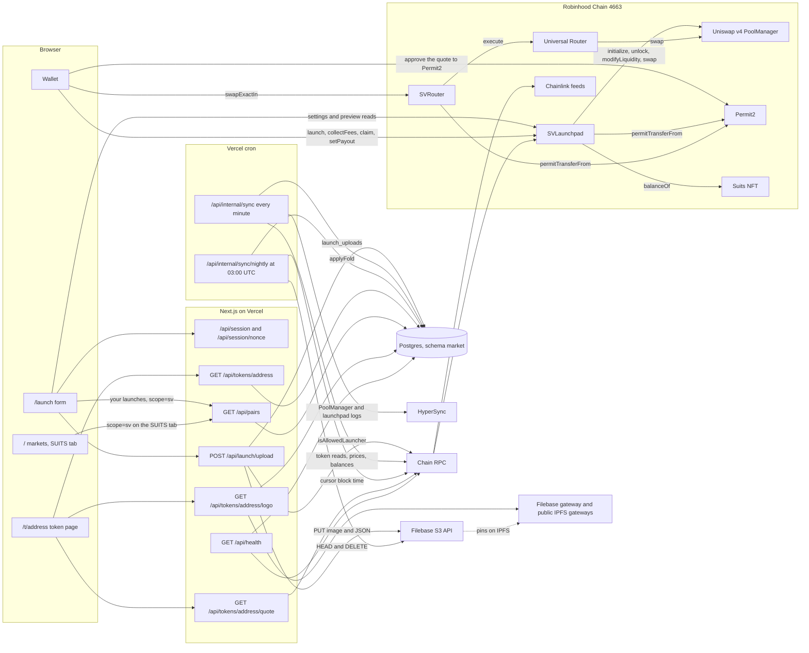
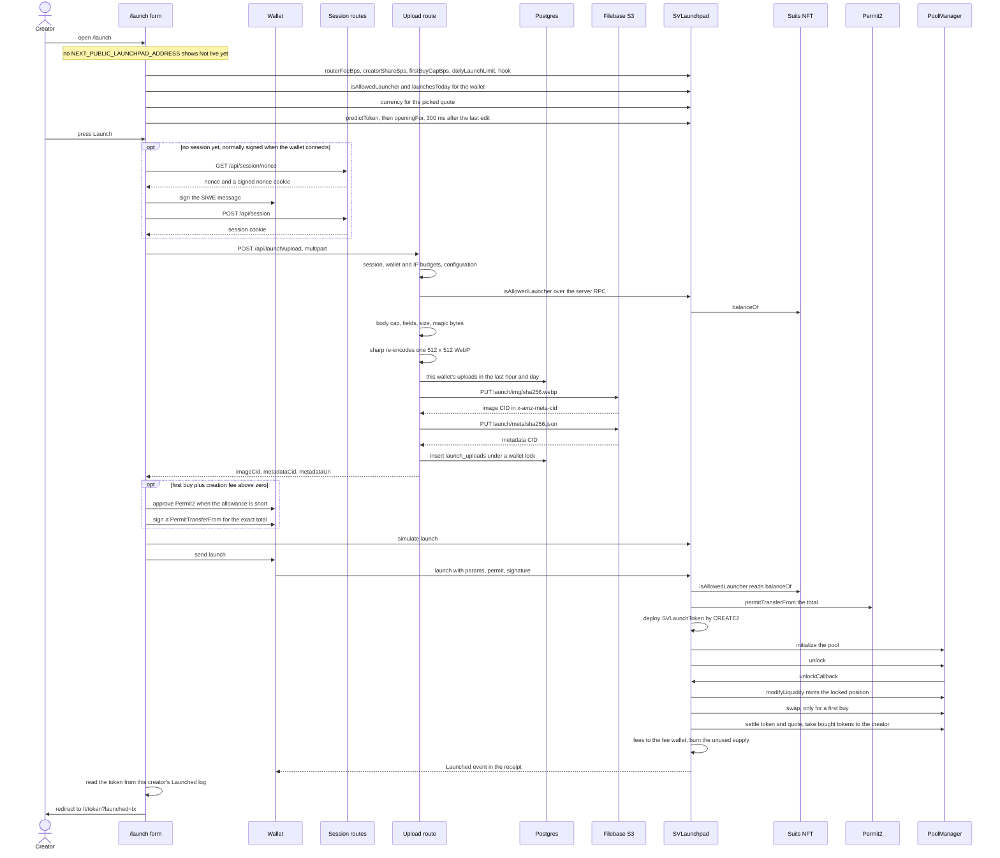
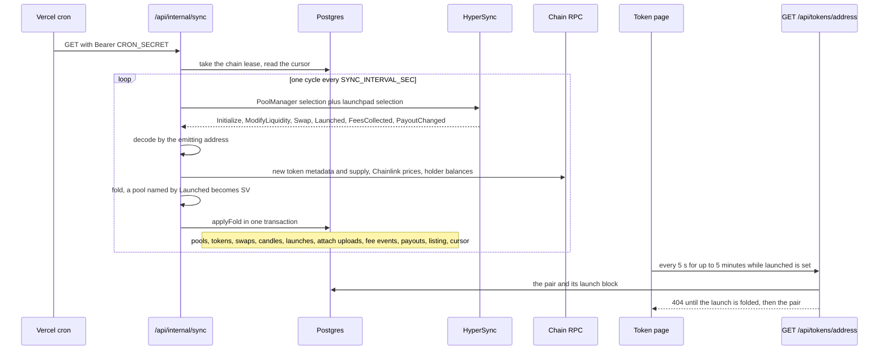
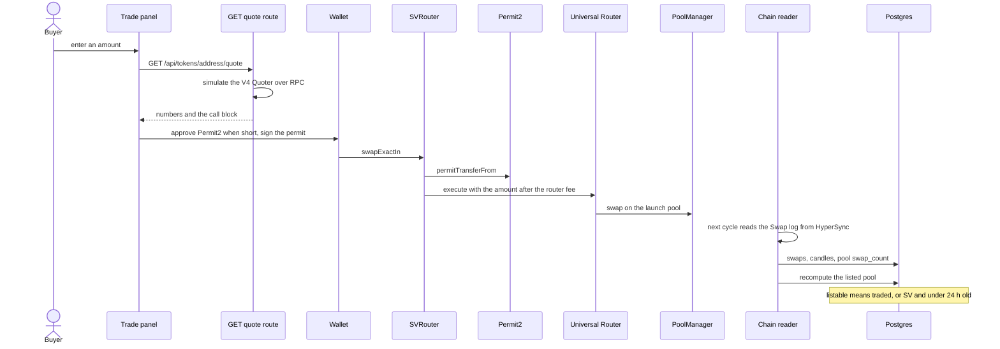
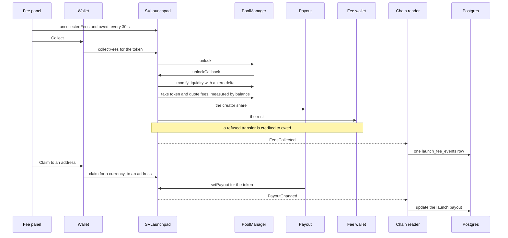
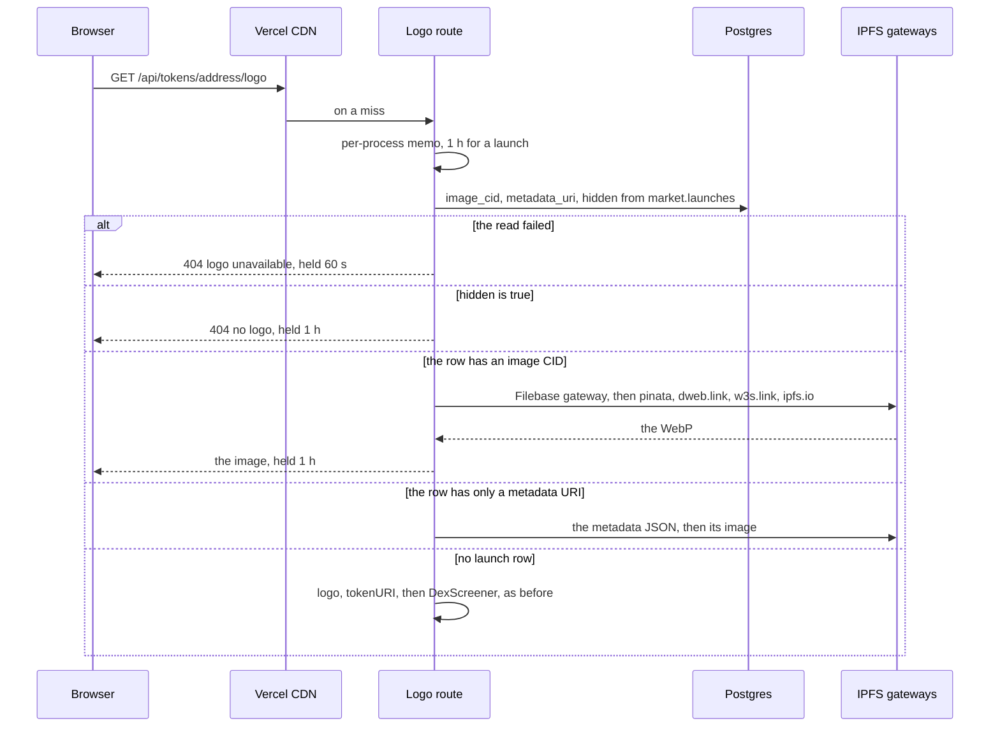
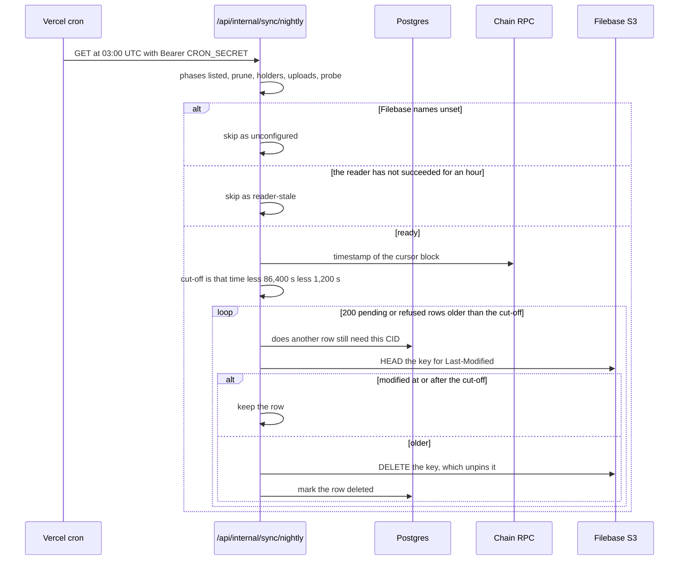
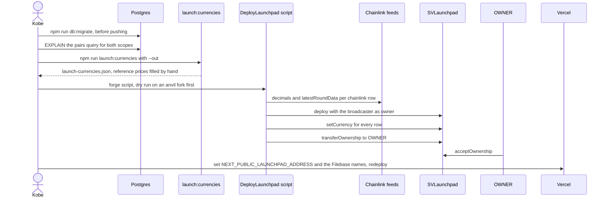

# The instant launchpad

Moved out of the README on 27 Oct 2026; the text is the README's own, lightly edited. Paths in backticks are relative
to the repo root; contract paths such as `src/SVLaunchpad.sol` are in the
[contracts repo](https://github.com/maxlong-markets/suitventures-markets-contracts). The data layer and the crons are in
[operations.md](operations.md).

The design is `docs/superpowers/specs/2026-09-28-instant-launchpad-design.md`. The reader adds the launchpad as a
second log selection in its per-minute HyperSync request and folds `Launched`, `FeesCollected` and `PayoutChanged`
into `market.launches` and `market.launch_fee_events`. A launched token lists from its launch block with the origin
`SV`, which the table, the origin chip and the token page all print as `SUITS`. A launched token keeps the SV origin,
but the badge follows the listed pool, so if another pool becomes the listed one the badge can differ. One nobody has
bought leaves the default table after the listing window below and returns with its first trade; its page stays up.
The Suits tab is fed by its own call, `GET /api/pairs?scope=sv`, which lists every launch newest first, bought or not
and listed or not. The launch page lists the connected wallet's own launches under the form, from the same list.
`POST /api/launch/upload` re-encodes a creator's image to a WebP and pins it and a metadata JSON on
Filebase before the launch. Only Suits holders may upload, within the per-wallet limits below. The nightly job's
`uploads` phase unpins what no launch used.

| Launchpad number | Value |
|---|---|
| Uploads per wallet per hour | 5 |
| Uploads per wallet per day | 20 |
| Launch image | 512 x 512 WebP |
| Listing window for a token nobody has bought | 24 hours |
| Token page re-reads after a launch | every 5 seconds, for up to 5 minutes |
| A hidden launch's logo answers "no logo" | within about 2 hours at worst |

To hide a launch's image and links, run this in the Supabase SQL editor:

    update market.launches set hidden = true where token_id = '<lowercase address>'

Rollout, in this order:

1. Apply the migration with `npm run db:migrate` before pushing. Without the launch tables every token page and
   `GET /api/tokens/[address]` fail, because the single-token query joins `market.launches`. `/api/health` answers
   503, and logos across the whole site fail, because every logo lookup reads `market.launches`.
2. Before rollout, run `EXPLAIN (ANALYZE, BUFFERS)` in production on the pairs query for both scopes, `all` and
   `launchpad`, and confirm the new order uses the `pools_activity` index. The query is `ORDER` in
   `src/lib/market/dbBackend.ts`.
3. Set `NEXT_PUBLIC_LAUNCHPAD_ADDRESS` only after the contract is deployed, and before anyone launches: a launch the
   reader has already passed over needs a catch-up rewind to appear. The value is fixed at build time, so setting or
   changing it takes a redeploy.
4. Set the Filebase names on Vercel. `FILEBASE_ACCESS_KEY`, `FILEBASE_SECRET_KEY` and `FILEBASE_BUCKET` are
   required. `FILEBASE_GATEWAY_URL` is optional and takes an https origin only.

## The launchpad end to end

This section follows one launch from the form to the nightly clean-up and names every endpoint it touches: the Next.js
routes, the cron jobs, the contract functions and events, and the outside services. It is read from the code on
`feat/instant-launchpad`, not from the design. The contract is `src/SVLaunchpad.sol` in the contracts repo, and the
browser's copy of its interface is `src/lib/launch/abi.ts`.

### The parts and how they connect

### Launching a token

The form reads every contract setting live and never hard-codes a fee or a share. The upload runs its checks in a fixed
order, so a request that fails early costs nothing further. The launch itself is one transaction.

### Indexing the launch

The chain reader is the only writer of launch rows. It adds the launchpad as a second log selection in the same
HyperSync request, so a launch and its pool arrive in one batch and the pool is labelled SV before it is written.

What `applyFold` does with the launch rows, in order:

| Step | Writes |
|---|---|
| 1 | `insertLaunches`: one `market.launches` row per `Launched`, nothing on conflict |
| 2 | `attachUploads`: copies image CID, description and links from the creator's matching `launch_uploads` row, marks it `used` |
| 3 | `insertLaunchFees`: one `market.launch_fee_events` row per `FeesCollected` log |
| 4 | `applyPayouts`: moves `market.launches.payout`, only forward by block and log index |
| 5 | `svWindowClosedTokens` and `recomputeListedPools`: the listing, including SV launches whose window just closed |
| 6 | `saveCursors`: the block cursor, in the same transaction |

### Trading after the launch

A launched pool is an ordinary hookless v4 pool, so trades go through the same path as every other pair.

| Listing rule | Value |
|---|---|
| An SV pool with no swaps stays listed for | 86,400 s |
| The per-cycle sweep looks back past a closed window for | 259,200 s |
| The nightly run recomputes the listing of | every token |

### Fees, claims and the payout

Anyone may call `collectFees`. The split uses the creator share fixed at launch. A transfer that fails is credited to
`owed` and taken later with `claim`.

The fee totals on the token page are never stored. `GET /api/tokens/[address]` sums `market.launch_fee_events` when it
builds the `launch` block.

### Logos and hiding a launch

A token launched here answers only from its own row. A launch row never falls through to the older logo sources.

| Logo number | Value |
|---|---|
| Memo for a launch logo, hit or hidden | 3,600 s |
| Browser and CDN hold for a launch logo | 3,600 s |
| Hold for a failed lookup | 60 s |
| Whole lookup budget | 25,000 ms |
| Largest image proxied | 2 MB |

Setting `hidden` also blanks the image CID, description and links in the `launch` block of `GET /api/tokens/[address]`.

### Nightly clean-up of unused uploads

The `uploads` phase runs between `holders` and `probe`. Its cut-off comes from the block the reader has reached, not the
wall clock, so an upload whose launch is not yet folded is never deleted.

| Upload status | Meaning |
|---|---|
| `pending` | pinned, no launch folded yet |
| `refused` | pinned, then refused by the locked recount |
| `used` | the reader matched it to a launch |
| `deleted` | the nightly phase removed its objects |

### Deploy and rollout

These are admin steps. The app never calls an owner setter.

| Deploy script name | Use |
|---|---|
| `OWNER` | the final owner, who must call `acceptOwnership` |
| `FEE_WALLET` | receives the router fee, the creation fee and the platform fee share |
| `LAUNCHER_GATE` | the Suits NFT; zero lets anyone launch |
| `POOL_MANAGER` | optional, defaults to the chain's PoolManager |
| `PERMIT2` | optional, defaults to canonical Permit2 |
| `ALLOW_OTHER_ADDRESSES` | optional, `true` allows another PoolManager or Permit2 |

The script reads `script/config/launch-currencies.json`, refuses any chain but 4663, and prices and checks every row
before it broadcasts. The deployer key is passed to forge with `--account`, `--ledger` or `--interactive`, never
through the environment.

### Every endpoint the launchpad touches

Next.js routes and pages:

| Endpoint | Method | Called by | Auth | Reads | Writes |
|---|---|---|---|---|---|
| `/launch` | page | creator | none to view | contract views through the wallet RPC, and `GET /api/pairs?scope=sv` for the connected wallet's own launches | nothing |
| `/t/[address]` | page | anyone, and the redirect with `?launched=<tx>` | none | the store through the backend | nothing |
| `/` with the SUITS origin chip | page | anyone | none | `GET /api/pairs?scope=sv` | nothing |
| `/api/session/nonce` | GET | the sign-in asked at wallet connect, or the form's fallback step | per-IP budget | nothing | nonce cookie, 10 minutes |
| `/api/session` | POST | the same, after the SIWE signature | nonce cookie, SIWE signature | nonce cookie | session cookie, 7 days |
| `/api/session` | GET | app | session cookie | session cookie | nothing |
| `/api/session` | DELETE | sign out | none | nothing | clears both cookies |
| `/api/launch/upload` | POST | form, on Launch | session cookie, 60 writes a minute per wallet, 10 uploads a minute per IP, 5 an hour and 20 a day per wallet | `isAllowedLauncher`, `market.launch_uploads` | Filebase PUT twice, one `market.launch_uploads` row |
| `/api/tokens/[address]` | GET | token page, every 5 s after a launch | none, cached 30 s | `market.tokens`, `pools`, `launches`, `launch_fee_events`, `quotes` | nothing |
| `/api/tokens/[address]/logo` | GET | every logo on the site | none, no query string | `market.launches`, IPFS gateways | nothing |
| `/api/tokens/[address]/quote` | GET | trade panel | none | V4 Quoter over RPC, the store | nothing |
| `/api/pairs` | GET | markets table | none | the store, `scope=all` or `scope=launchpad`, the second now including SV | nothing |
| `/api/pairs?scope=sv` | GET | the SUITS chip on the markets table, and the launch page's list of the wallet's own launches | none, cached 30 s | `market.launches` with its tokens, pools and quotes: every launch newest first, at most 500, bought or not, listed or not, hidden ones included | nothing |
| `/api/health` | GET | monitors | none | the `launches` block, `sync.lastCycle.launchEvents` | nothing |
| `/api/internal/sync` | GET | Vercel cron, every minute | Bearer `CRON_SECRET` | HyperSync, chain RPC | every launch table, the listing, the cursor |
| `/api/internal/sync/nightly` | GET | Vercel cron, 03:00 UTC | Bearer `CRON_SECRET` | `market.sync_state`, `launch_uploads`, block time over RPC | Filebase HEAD and DELETE, `launch_uploads.status` |

Contract functions the app sends:

| Function | Who | Effect |
|---|---|---|
| `launch(p, permit, signature)` | a Suits holder | deploys the token, opens and funds the pool, optional first buy, emits `Launched` |
| `collectFees(token)` | anyone | pokes the position, splits the fees, emits `FeesCollected` |
| `claim(currency, to)` | anyone with `owed` | pays what a failed delivery left, no event |
| `setPayout(token, payout)` | the current payout | moves the payout, emits `PayoutChanged` |
| `approve(Permit2, max)` on the quote | creator or buyer | only when the allowance is short |
| `swapExactIn` on SVRouter | buyer | the ordinary trade path |

Contract views the app reads:

| View | Read by | When |
|---|---|---|
| `routerFeeBps`, `creatorShareBps`, `firstBuyCapBps`, `dailyLaunchLimit`, `hook` | form | every 30 s |
| `isAllowedLauncher(account)`, `launchesToday(account)` | form | every 30 s |
| `isAllowedLauncher(account)` | upload route | every upload |
| `currency(quote)` | form | every 30 s, and after a `PermitMismatch` |
| `predictToken(creator, salt, name, symbol)` | form | 300 ms after the last edit |
| `openingFor(token, quote, valuation)` | form | after `predictToken` |
| `uncollectedFees(token)` | fee panel | every 30 s |
| `owed(account, currency)` | fee panel | every 30 s, for the token and the quote |

In the ABI but not read by the app: `getLaunch`, `poolKeyOf`, `launchCount`, `feeWallet`, `launcherGate`,
`POOL_MANAGER`, `PERMIT2`.

Events:

| Event | Emitted by | Folded into |
|---|---|---|
| `Launched` | `launch` | `market.launches`, the pool and token become SV |
| `FeesCollected` | `collectFees` | `market.launch_fee_events` |
| `PayoutChanged` | `setPayout` | `market.launches.payout` |
| `FeeWalletChanged`, `RouterFeeChanged`, `CreatorShareChanged`, `FirstBuyCapChanged`, `DailyLaunchLimitChanged`, `LauncherGateChanged`, `HookChanged`, `CurrencyChanged` | owner setters and the constructor | not read by the reader |

Owner-only setters, admin work, never called by the app: `setFeeWallet`, `setRouterFee`, `setCreatorShare`,
`setFirstBuyCap`, `setDailyLaunchLimit`, `setLauncherGate`, `setHook`, `setCurrency`, and `transferOwnership` with
`acceptOwnership`. `renounceOwnership` always reverts.

Outside services:

| Service | Called by | Calls |
|---|---|---|
| Uniswap v4 PoolManager | `launch`, `collectFees` | `initialize`, `unlock`, then `modifyLiquidity`, `swap`, `sync`, `settle`, `take` inside the callback |
| Permit2 | `launch`, SVRouter | `permitTransferFrom`, a signature transfer |
| Suits NFT | `isAllowedLauncher` | `balanceOf` with a gas cap |
| SVRouter and Universal Router | trades after launch | `swapExactIn`, then `execute` |
| HyperSync | chain reader | one query a cycle, the launchpad selection filtered by address and the 3 activity topics |
| Chain RPC, `CHAIN_RPC_URL` then `CHAIN_RPC_FALLBACK_URL` | upload route, chain reader, nightly, health | `isAllowedLauncher`, token metadata and supply, holder balances, Chainlink prices, block time, chain head |
| Chain RPC, `ROBINHOOD_RPC_URL` | logo route | `logo` and `tokenURI` for tokens not launched here |
| Chainlink feeds | deploy script, chain reader | `decimals`, `latestRoundData` |
| Filebase S3 API | upload route, nightly | PUT, HEAD, DELETE on `FILEBASE_BUCKET`, the CID from `x-amz-meta-cid` |
| Filebase gateway, `FILEBASE_GATEWAY_URL` | logo route | the first of 5 gateways tried |

Postgres tables:

| Table | Written by | Read by |
|---|---|---|
| `market.launches` | chain reader, and `hidden` by hand | token route, logo route, health, `attachUploads`, pairs with `scope=sv` |
| `market.launch_fee_events` | chain reader | token route |
| `market.launch_uploads` | upload route, chain reader, nightly | upload route, nightly, health |
| `market.pools` | chain reader, origin SV from `Launched` | pairs, token route, listing |
| `market.tokens` | chain reader, origin SV and `listed_pool_id` | pairs, token route |
| `market.sync_state` | both cron jobs | nightly for the cursor and the reader's last success |
